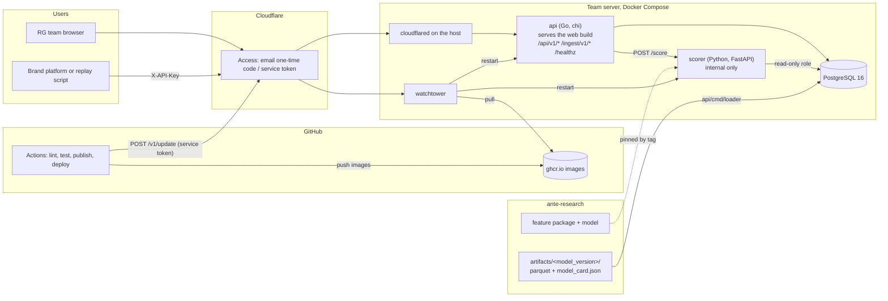
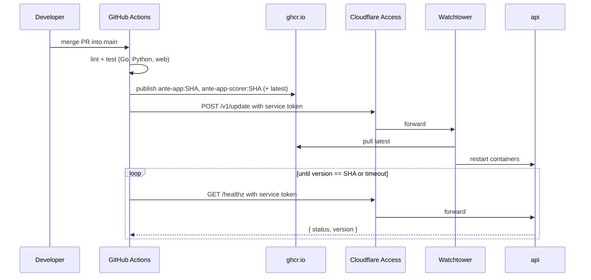

# Ante: architecture

Ante is a monitoring system for the responsible-gambling (RG) team of a casino group with five licensed brands (P1–P5). The regulator's licence conditions require the group to monitor its players. The brands' platforms send player game events; the system ranks players by how closely their behaviour resembles loss chasing and gives the RG team a review queue, a case view with reasons, and a per-brand overview. Every user sees all five brands.

This document is the build spec for [`ante-app`](https://github.com/ante-rg/ante-app). The API contract is in [`openapi.yaml`](https://github.com/ante-rg/ante-app/blob/main/openapi.yaml). UI decisions are in [`frontend-decisions.md`](frontend-decisions.md); visual tokens are in [`web/src/styles/tokens.css`](https://github.com/ante-rg/ante-app/blob/main/web/src/styles/tokens.css).

## 1. Components



| Component | Tech | Owns |
|---|---|---|
| `api` | Go 1.27, chi, pgx, sqlc, goose, oapi-codegen strict server | Dashboard read API, reviews, ingest, auth, audit log. Serves the built frontend. |
| `loader` | Go command in the same module (`cmd/loader`), parquet-go | Loads DS artifacts into Postgres, idempotent per `model_version`. |
| `fakeartifacts` | Go command (`cmd/fakeartifacts`) | Writes a synthetic `artifacts/dummy-v0/` set in the §4 format until the data science team publishes real artifacts. |
| `scorer` | Python 3.12, FastAPI, the data science feature package pinned by tag | Scores one player from stored events. Same feature code as training. Internal only. |
| `web` | React 19 + TypeScript, Vite, React Router, TanStack Query, Radix Primitives, visx, Biome | Four screens from wireframe A. |
| `postgres` | PostgreSQL 16 | All state. |
| `cloudflared` | Cloudflare Tunnel, already running on the server host (not in compose) | Public entry. No open inbound ports on the server. |

The scorer is only on the internal Docker network. Only `api` talks to it.

## 2. Two data paths

**Replay path (the dashboard).** Scores for every player and day are computed offline by the data science team and loaded by `loader`. The dashboard only reads. Moving the replay slider is a cheap indexed query, never a re-score. 100 players × up to 772 days is about 77,000 score rows.

**Ingest path (live demo of the operator integration).** `POST /ingest/v1/events` stores a batch of events, calls the scorer for that player and returns the score, band and reasons. This shows how an operator would integrate. Live scores are written to `live_scores` and never overwrite the precomputed replay data.

### Scorer internal API

Not part of `openapi.yaml`; only `api` calls it.

```
POST http://scorer:8000/score
{ "operator_code": "P3", "player_id": "S086" }
→ 200 { "score": 0.91, "reasons": [{ "code", "text", "weight" }], "model_version": "v0.3.0", "last_event_order": 640616 }
GET  http://scorer:8000/healthz → { "status": "ok", "model_version": "v0.3.0" }
```

The scorer reads the player's events from Postgres with a read-only role, builds features with the data science team's feature package, and loads the model file from `artifacts/<model_version>/model/`. Timeout from `api`: 5 s. If the scorer fails, `api` still stores the events and answers 503 with `score: null`.

## 3. Replay semantics

The data has no calendar dates. Every player's history starts at their own day 0.

- `as_of_day = N` means: show each player as they were **N days after their own first activity**.
- If a player's history ends before N, show their last day and mark them `history_ended_on_day`. They stay in the ranking.
- Bands are recomputed for each N by rank across all players: `high` = top 10%, `elevated` = next 10%, `low` = the rest. With 100 players that is 10 / 10 / 80.
- Before a player has enough history the DS team may emit `score = null`. Such players get band `insufficient_data` and are excluded from ranking.
- `as_of_day` defaults to `replay.default_day` from `GET /api/v1/replay`. The frontend keeps it in the URL query (`?day=120`) so a view can be shared.

## 4. Data handoff from ante-research

The data science team publishes a versioned folder `artifacts/<model_version>/`. The loader validates and loads it. This folder is the contract between the two repositories; changes to it need a PR in both. Until the first real artifacts exist, `api/cmd/fakeartifacts` writes a synthetic `artifacts/dummy-v0/` set in this format, so the app can be built and demonstrated end to end.

| File | Grain | Columns |
|---|---|---|
| `players.parquet` | player | `player_id`, `operator_code`, `last_day`, `session_count`, `deposit_count` |
| `daily_scores.parquet` | player × day | `player_id`, `day`, `score` (0–1, nullable), `reasons` (JSON list of `{code, text, weight}`, top 3) |
| `daily_activity.parquet` | player × day with activity | `player_id`, `day`, `deposits_n`, `deposits_eur`, `sessions_n`, `play_minutes`, `net_result_eur`, `chase_sessions_n`, `night_sessions_n`, `end_balance_eur` |
| `sessions.parquet` | session | `player_id`, `session_no`, `start_day`, `duration_s`, `deposits_n`, `deposits_eur`, `net_result_eur`, `is_night`, `is_chase` |
| `rule_flags.parquet` | player × day × rule | `player_id`, `day`, `rule_id`, `rule_text` |
| `review_sample.parquet` | player | `player_id`, `source` (`model` / `rules` / `both`), `position` (shuffled order) |
| `model_card.json` | model | text sections, metrics per window and per held-out operator, known limits |

Reason texts are written by the DS team (template sentences filled from SHAP values). The backend stores and returns them as they are; it never builds reason text itself.

## 5. Database

Migrations with goose in `api/migrations`. Queries with sqlc in `api/internal/store/queries`.

```sql
operators      (code text pk, name text, api_key_hash text)
players        (player_id text pk, operator_code text fk, last_day int, session_count int, deposit_count int)
models         (model_version text pk, card jsonb, loaded_at timestamptz, is_active bool)
daily_scores   (model_version, player_id, day int, score real null, reasons jsonb, pk(player_id, model_version, day))
daily_activity (player_id, day, ...numeric columns..., pk(player_id, day))
sessions       (player_id, session_no, start_day, ..., pk(player_id, session_no))
rule_flags     (player_id, day, rule_id, rule_text, pk(player_id, day, rule_id))
review_sample  (model_version, player_id, source text, position int)
reviews        (id bigserial pk, player_id, as_of_day int, outcome text, note text, reviewer text,
                blind bool, model_version text, created_at timestamptz default now())   -- append-only
events         (operator_code, player_id, event_order bigint, payload jsonb, received_at timestamptz,
                unique(operator_code, player_id, event_order))
live_scores    (player_id, scored_at timestamptz, last_event_order bigint, score real, reasons jsonb)
audit_log      (id bigserial, at timestamptz, actor text, method text, path text, status int)
```

Ranking for a day is computed in SQL with a window function over `daily_scores` joined to each player's effective day `least(N, last_day)`. If this is slow, add a materialised view `daily_ranks` refreshed by the loader.

`reviews` is append-only. The latest row per player is the current outcome; earlier rows are the history shown in the case view.

## 6. Blind review

Blind mode is enforced by the server, not by blurring in the browser.

- `GET /api/v1/queue?mode=blind` returns the players from `review_sample` in `position` order, with `score`, `band`, `rank`, `source` and `reasons` omitted.
- `GET /api/v1/players/{id}?mode=blind` omits the same fields.
- Reviews saved in blind mode carry `blind = true`. The comparison (model list vs rule list) is computed afterwards from `reviews` joined to `review_sample`.

## 7. Auth and audit

- Dashboard: Cloudflare Access in front. `api` trusts the `Cf-Access-Authenticated-User-Email` header only when the request also carries a valid `Cf-Access-Jwt-Assertion` (verify against the team's JWKS). In local development, `AUTH_DEV_USER` replaces both.
- Ingest: `X-API-Key` per operator, stored as a hash. A key can only write its own operator's players.
- Every request is written to `audit_log` with the actor (email or operator code).

## 8. Deployment

- Server: the team's own machine (Ubuntu 24.04, amd64). Images are built for `linux/amd64` only.
- `deploy/docker-compose.yml`: `postgres`, `api` (also serves `web`, published on `127.0.0.1:8080` only), `scorer` (internal network only), and `watchtower` (`nickfedor/watchtower`, under the `server` profile, HTTP API on `127.0.0.1` only). There is no `cloudflared` container: the tunnel already runs on the host and routes `ante.<domain>` to `http://localhost:8080`, with Cloudflare Access in front.
- GitHub Actions in `ante-app` (`ci.yml`): on PR, lint and tests for Go, Python and TypeScript, a generated-code drift check, the contract test, and an image build with a compose smoke test; on `main`, a `publish` job pushes `ghcr.io/ante-rg/ante-app` and `ghcr.io/ante-rg/ante-app-scorer` (`:<sha>` and `:latest`) only after every check passes.
- A `deploy` job follows `publish`. It calls Watchtower's HTTP API (`POST /v1/update`) on a second hostname protected by Cloudflare Access with a service token, then polls `/healthz` until its `version` equals the commit SHA, and fails after a timeout. GitHub holds only the Access service token and the Watchtower token: no SSH keys, no inbound ports.
- Fallback for the viva: `make up` (compose with `deploy/local.yml`) on a laptop with the synthetic dataset.



## 9. Contract test

One CI job checks that the scorer and the offline model agree:

1. Take `fixtures/contract/` (a few synthetic players with their events and the expected scores from `ante-research`).
2. Feed the events through `POST /ingest/v1/events`.
3. Assert `|live_score - expected_score| < 1e-6` for each player.

This is the check that catches training/serving skew (time zones, session boundaries, rounding).

## 10. Data rules

- Raw parquet files and `artifacts/` are never committed. `.gitignore` covers `*.parquet` and `artifacts/`.
- The public repositories contain code, aggregates, the synthetic dataset and fixtures only.
- Logs never contain event payloads.
