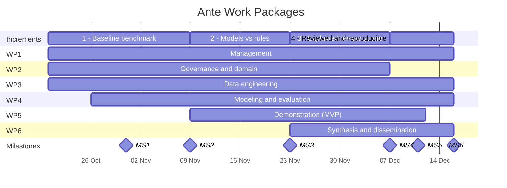

# Ante Project Plan

This plan supports the course portfolio. It sets out the project objectives, the six thematic work packages (WPs) that deliver them, the four Product Increments, and six milestones that pace the work.

## Objectives

Each objective is due at a milestone, and each milestone checks the objectives due at that point.

| ID | Objective                                                                                                                                                                                                                        | Due         | Milestone | Main WPs      |
| -- | -------------------------------------------------------------------------------------------------------------------------------------------------------------------------------------------------------------------------------- | ----------- | --------- | ------------- |
| O1 | Build a one-command pipeline turning at least 100 accounts' raw events into sessions and behavioral markers, freeze the outcome label and evaluation protocol, and score the rule baseline against the label.                    | 08 Nov 2026 | MS2       | WP2, WP3, WP4 |
| O2 | Compare two machine-learning models with the rule baseline on the share of harm-related events flagged 7 to 30 days ahead at a 5% review capacity, using player-grouped cross-validation and bootstrap confidence intervals.     | 22 Nov 2026 | MS3       | WP4           |
| O3 | Deploy an API and a dashboard that score a replayed event stream, return each score with its top three reasons, and pass tests confirming that API scores match the offline model.                                               | 06 Dec 2026 | MS4       | WP5           |
| O4 | Conduct a blind review of 40 player cases, 20 flagged only by the model and 20 only by the rules, each rated by two members against a fixed rubric, and report the share judged concerning per group with inter-rater agreement. | 10 Dec 2026 | MS5       | WP6           |
| O5 | Publish the documented pipeline with a model card covering data protection, ethical risks and limitations, verified by an independent rerun.                                                                                     | 15 Dec 2026 | MS6       | WP6           |

## Product Increments

Each increment closes on a milestone and adds something the team can show.

| Increment                     | Planned dates             | What it adds                                                                                                                                           | Closing milestone | Objectives |
| ----------------------------- | ------------------------- | ------------------------------------------------------------------------------------------------------------------------------------------------------ | ----------------- | ---------- |
| 1 - Baseline benchmark        | 20 Oct 2026 - 08 Nov 2026 | We know how well transparent rules flag at-risk players on our data, and have the pipeline, label, and frozen protocol to test any model against them. | MS2               | O1         |
| 2 - Models vs rules           | 09 Nov 2026 - 22 Nov 2026 | The first answer to the research question, and a walking-skeleton MVP serving baseline scores end to end.                                              | MS3               | O2         |
| 3 - Explained review queue    | 23 Nov 2026 - 06 Dec 2026 | An analyst can open the MVP and see players ranked by the selected model, each with its top three reasons, over a replayed event stream.               | MS4               | O3         |
| 4 - Reviewed and reproducible | 07 Dec 2026 - 15 Dec 2026 | Flagged cases have been checked by people, the pipeline and model card are published, and the results are presented with a live demo.                  | MS6               | O4, O5     |

## Milestones

MS2, MS3, MS4, and MS6 close an increment. MS1 is a data gate before modeling work can start, and MS5 freezes the results before the final write-up.

| Milestone | Description                     | Planned date | Closes      | Evidence                                                                                                                   |
| --------- | ------------------------------- | ------------ | ----------- | -------------------------------------------------------------------------------------------------------------------------- |
| MS1       | Data and label source confirmed | 30 Oct 2026  | -           | Data management plan reviewed, dataset for Increment 1 decided, and source of harm-event labels decided                    |
| MS2       | Baseline ready                  | 08 Nov 2026  | Increment 1 | O1: pipeline runs with one command, label and evaluation protocol frozen before any model is trained, rule baseline scored |
| MS3       | Models compared                 | 22 Nov 2026  | Increment 2 | O2: models compared with the baseline; walking-skeleton MVP serves baseline scores end to end                              |
| MS4       | MVP complete                    | 06 Dec 2026  | Increment 3 | O3: MVP serves the selected model's scores with top three reasons, parity tests pass, demonstrated at the iteration review |
| MS5       | Results frozen                  | 10 Dec 2026  | -           | O4: blind case review reported; all reported results final and traceable, with no new experiments after this point         |
| MS6       | Final delivery                  | 15 Dec 2026  | Increment 4 | O5: documented pipeline and model card published; portfolio and presentation materials complete                            |

## Work Packages

Each WP has a lead (accountable person), objectives, deliverables, and planned timing. Deliverables are tagged by type: R for report, S for software, D for data.

### WP1: Project management and documentation

**Lead:** Jurijs. **Active:** all increments. **Objectives:** all (supporting).

This WP keeps the project coordinated, documented, and on track, covering Data Driven Scrum events, the backlog, risk management, and the project's administrative record.

- D1.1 Project proposal and charter (R, due 20 Oct)
- D1.2 Risk register (R, initial version due 20 Oct, continuously updated)
- D1.3 Meeting and iteration logs (R, continuous until 15 Dec)
- D1.4 Project portfolio: README index, contributions, and process evidence (R, due 15 Dec)

### WP2: Data governance and domain knowledge

**Lead:** Jurijs. **Active:** mainly Increments 1-2. **Objectives:** O1.

This WP secures lawful, ethical access to player data and turns domain expertise into the problem definition and the rule-based baseline that every model is compared against.

- D2.1 Data management plan, including GDPR and ethics considerations (R, due 30 Oct)
- D2.2 Problem specification: target label, prediction horizons, look-back window (R, due 1 Nov)
- D2.3 Domain indicator catalog and rule-based baseline (R+S, due 8 Nov; the catalog later records the H1-H8 results)

### WP3: Data engineering

**Lead:** Arturs. **Active:** mainly Increments 1-2, with support later. **Objectives:** O1.

This WP produces clean, reproducible, leakage-safe data for all downstream work, from ingestion and quality checks to features and validation folds.

- D3.1 Data quality and exploration report (R, due 6 Nov)
- D3.2 Reproducible data and feature pipeline (S, first version by 8 Nov, extended until 22 Nov)
- D3.3 Versioned modeling dataset with player-grouped folds (D, due 8 Nov)

### WP4: Predictive modeling and evaluation

**Lead:** Andrejs. **Active:** all increments, mainly 2-3. **Objectives:** O1, O2.

This WP develops and evaluates the machine-learning models, always against the rule-based baseline and under an evaluation protocol fixed before any modeling.

- D4.1 Evaluation protocol: metrics, review capacity, horizons, validation scheme (R, due 6 Nov)
- D4.2 Comparison of models with the rule-based baseline, including early recall, lead time, and per-brand results (R, due 22 Nov)
- D4.3 Selected model with per-player explanations (R+S, due 29 Nov)

### WP5: Demonstration (MVP)

**Lead:** Volodymyr. **Active:** Increments 2-4. **Objectives:** O3.

This WP builds the MVP: an API and an analyst dashboard that serve the risk scores as a ranked review queue, first for the baseline and then for the selected model.

- D5.1 Walking skeleton: API and dashboard serving the baseline (S, due 22 Nov)
- D5.2 MVP with the selected model, top three reasons, event replay, and parity tests (S, due 6 Dec)
- D5.3 Technical and user documentation (R, due 11 Dec)

### WP6: Synthesis and dissemination

**Lead:** Daniils. **Active:** mainly Increments 3-4. **Objectives:** O4, O5.

This WP brings the results together: it checks what the model and the rules flag in a blind case review, documents the pipeline so others can rerun and adapt it, and presents the findings.

- D6.1 Blind case review of players flagged only by the model or only by the rules (R, due 10 Dec)
- D6.2 Documented pipeline and model card (R+S, due 15 Dec)
- D6.3 Final presentation and live demo (R, materials due 15 Dec; presentation date per course schedule)

## WP vs Increments

|     | Increment 1 | Increment 2 | Increment 3 | Increment 4 |
| --- | :---------: | :---------: | :---------: | :---------: |
| WP1 |      ●      |      ●      |      ●      |      ●      |
| WP2 |      ●      |      ●      |      ○      |             |
| WP3 |      ●      |      ●      |      ○      |      ○      |
| WP4 |      ○      |      ●      |      ●      |      ○      |
| WP5 |             |      ●      |      ●      |      ○      |
| WP6 |             |             |      ○      |      ●      |

● marks main focus, ○ marks lighter or supporting activity.

