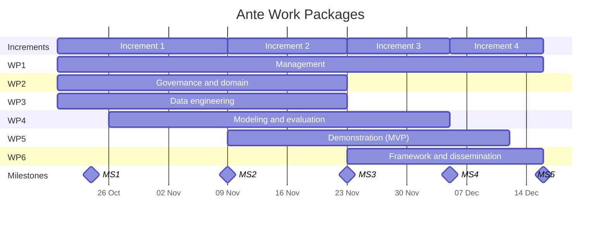

# Ante Project Plan

This plan supports the course portfolio. It organizes the work into six thematic work packages (WPs) delivered across four Product Increments, with final submission assumed due on 15 December 2026. Assigned people, meetings, and outcomes will be recorded only after the team confirms them.

## Product Increments

| Increment   | Planned dates             | Closing milestone |
| ----------- | ------------------------- | ----------------- |
| Increment 1 | 20 Oct 2026 - 08 Nov 2026 | MS2               |
| Increment 2 | 09 Nov 2026 - 22 Nov 2026 | MS3               |
| Increment 3 | 23 Nov 2026 - 04 Dec 2026 | MS4               |
| Increment 4 | 05 Dec 2026 - 15 Dec 2026 | MS5               |

## Work Packages

Each WP has a lead (accountable person), objectives, deliverables, and planned timing. Deliverables are tagged by type: R for report, S for software, D for data.

### WP1: Project management and documentation

**Lead:** Jurijs. **Active:** all increments.

This WP keeps the project coordinated, documented, and on track toward its milestones. It covers DDS facilitation (regular meetings, iteration reviews, retrospectives), backlog hygiene in GitHub Projects, risk management, and the project's administrative record.

- D1.1 Project proposal and charter (R, due 20 Oct)
- D1.2 Risk register (R, due 8 Nov, continuously updated)
- D1.3 Meeting and iteration logs (R, continuous until 15 Dec)

### WP2: Data governance and domain knowledge

**Lead:** Jurijs. **Active:** mainly Increments 1-2.

This WP secures lawful, ethical access to player data and turns domain expertise into a precise problem definition. Its most critical output is the target definition: what counts as problematic gambling in the data, and how early a prediction must be to count as early. It also owns the rule-based baseline, since that is essentially codified domain knowledge.

- D2.1 Data management plan, including GDPR and ethics considerations (R, due 23 Oct)
- D2.2 Problem specification: target label, prediction horizon, observation window (R, due 1 Nov)
- D2.3 Domain indicator catalog and rule-based baseline (R+S, first version by 8 Nov, final by 22 Nov)

### WP3: Data engineering

**Lead:** Arturs. **Active:** mainly Increments 1-2, with support later.

This WP produces clean, reproducible, leakage-safe data for every downstream activity. It covers ingestion, quality assessment, exploratory analysis, feature engineering, and temporal train/validation/test splits.

- D3.1 Data quality and exploration report (R, due 6 Nov)
- D3.2 Reproducible data and feature pipeline (S, due 20 Nov)
- D3.3 Versioned modeling dataset with temporal splits (D, due 20 Nov)

### WP4: Predictive modeling and evaluation

**Lead:** Andrejs. **Active:** Increments 1-3.

This WP develops and rigorously evaluates ML models for early detection, always measured against the rule-based baseline. It starts with an evaluation protocol written *before* any modeling, so results cannot be judged against moving goalposts. It then iterates on models, explainability, and fairness.

- D4.1 Evaluation protocol: metrics, thresholds, validation scheme (R, due 6 Nov)
- D4.2 Baseline vs. initial models comparison (R, due 22 Nov)
- D4.3 Final models with explainability and fairness analysis (R+S, due 4 Dec)

### WP5: Demonstration (MVP)

**Lead:** Volodymyr. **Active:** Increments 2-4.

This WP builds the MVP used to demonstrate the approach to stakeholders. It follows the walking-skeleton strategy: first serve the rule-based baseline end to end, then swap in the ML model with explanations.

- D5.1 Prototype API and dashboard serving the baseline (S, due 22 Nov)
- D5.2 MVP v1 with ML model and explanations (S, due 4 Dec)
- D5.3 Technical and user documentation (R, due 11 Dec)

### WP6: Framework and dissemination

**Lead:** Daniils. **Active:** mainly Increments 3-4.

This WP distills the project's methods and findings into a reusable framework for others to apply, and communicates the results. It covers the method itself (problem definition, indicators, evaluation, deployment), code templates, and the final presentation.

- D6.1 Reusable early-detection framework: method description and code templates (R+S, due 11 Dec)
- D6.2 Final presentation and live demo (materials due 15 Dec; presentation date per course schedule)

## Milestones

| Milestone | Description                        | Planned date | Evidence                                                                                 |
| --------- | ---------------------------------- | ------------ | ---------------------------------------------------------------------------------------- |
| MS1       | Data access confirmed              | 23 Oct 2026  | Data agreement in place and data available to the team                                   |
| MS2       | Problem defined and baseline ready | 08 Nov 2026  | Target specification agreed, evaluation protocol fixed, first baseline results available |
| MS3       | End-to-end prototype               | 22 Nov 2026  | Pipeline running, first models compared with the baseline, MVP serving the baseline      |
| MS4       | Stakeholder MVP demo               | 04 Dec 2026  | MVP running the ML model with explanations, demonstrated to stakeholders                 |
| MS5       | Final delivery                     | 15 Dec 2026  | Framework, documentation, and presentation complete                                      |

## WP vs Increments

|     | Increment 1 | Increment 2 | Increment 3 | Increment 4 |
| --- | :---------: | :---------: | :---------: | :---------: |
| WP1 |      ●      |      ●      |      ●      |      ●      |
| WP2 |      ●      |      ●      |      ○      |             |
| WP3 |      ●      |      ●      |      ○      |      ○      |
| WP4 |      ○      |      ●      |      ●      |      ○      |
| WP5 |             |      ●      |      ●      |      ○      |
| WP6 |             |             |      ○      |      ●      |

● marks main focus, ○ marks lighter or supporting activity.

The Gantt dates are planned tasks, not proof of completed work. The [iteration log](iteration_log.md) records actual work and feedback.
